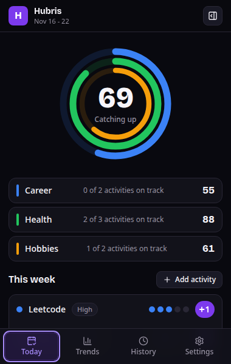
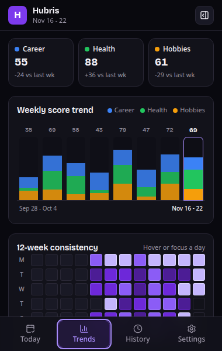
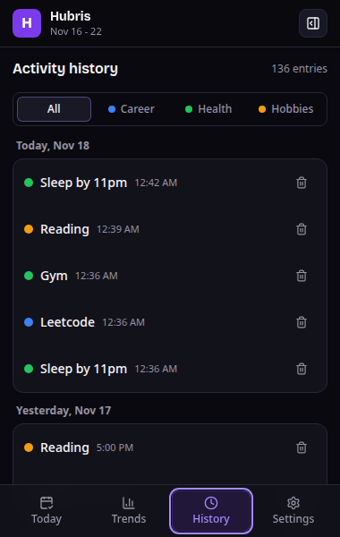
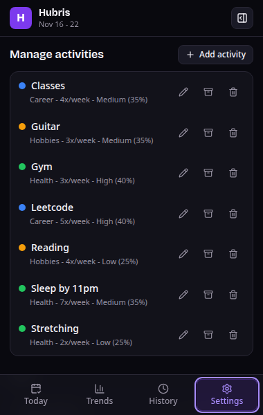
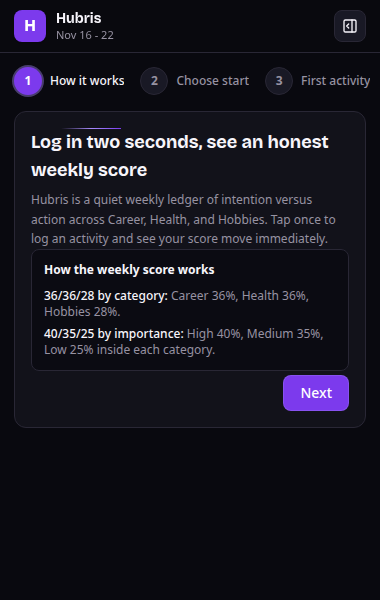
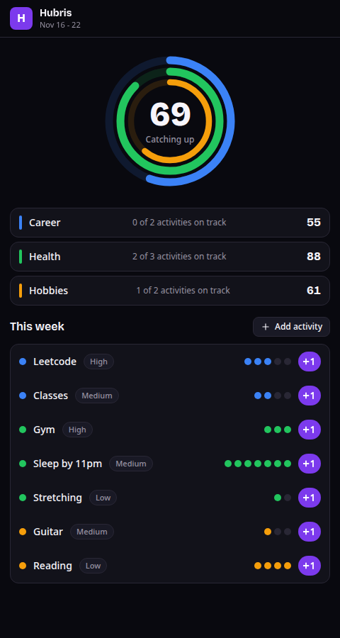
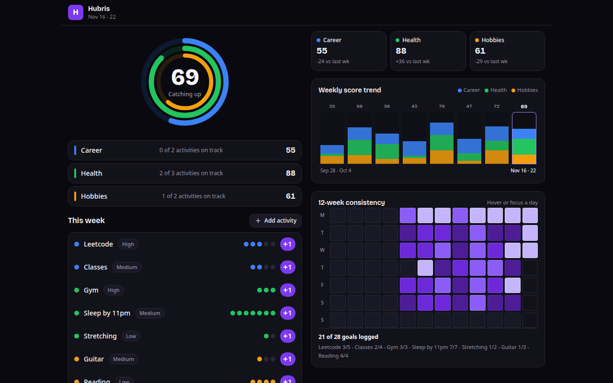

# Hubris - Track Everything

A modern, local-first tracking app for activities, habits, and goals.

Small logs. Clear direction.
Hubris compares what you meant to do this week with what you did, and turns it into one honest score across Career, Health, and Hobbies.



## Status

- **Chrome extension** (`apps/extension`): working and tested. Log activities, see this week's score, trends, and history, and back up your data. Loads unpacked in Chrome 116 or newer.
- **Scoring core** (`packages/core`): the weekly weighted score from the spec is implemented and unit tested with hand-checked worked examples.
- **Mobile app** (`apps/mobile`): Expo prototype, not part of the extension work and not covered by CI yet.
- **Entertainment**: planned as a separate catalog with its own score; not built yet (see "What is next").

## Tech Stack

- **Monorepo**: Turborepo + pnpm workspaces
- **Mobile**: React Native + Expo + TypeScript + SQLite
- **Extension**: React + Vite + TypeScript + IndexedDB, Tailwind CSS v4, Manifest V3
- **Backend** (future): Fastify + Prisma + PostgreSQL

## Load the extension in Chrome

From a zip (attached to a GitHub release, downloaded from a CI run's artifacts, or built locally from the repo root with `pnpm turbo run build --filter=@hubris/extension...` and then `pnpm --filter=@hubris/extension package`, which needs the `zip` command):

1. Unzip `hubris-extension-<version>.zip` into a folder.
2. Open `chrome://extensions` and switch on **Developer mode** (top right).
3. Click **Load unpacked** and choose the unzipped folder, then pin Hubris from the puzzle-piece menu.

From source:

```bash
pnpm install --filter '!@hubris/mobile'
pnpm turbo run build --filter=@hubris/extension...
```

Then load `apps/extension/dist` with **Load unpacked** as in step 3.

## How the score works

The score follows the spec in `docs/SPEC.md`.

1. Each activity has a weekly goal ("5 times a week") and an importance (High, Medium, or Low).
2. An activity scores `(times done this week / weekly goal) * 100`, capped at 100.
3. A category score weighs its activities by importance: 40% High, 35% Medium, 25% Low. Activities with the same importance are averaged.
4. The overall score is `36% Career + 36% Health + 28% Hobbies`.
5. Weeks run Monday to Sunday in your local time.

Worked example: Leetcode is High with a goal of 5 and was done 3 times (60); Classes is Medium with a goal of 4 and was done twice (50).
There is no Low activity in Career, so the High and Medium weights are rescaled to fill the category: (0.40 x 60 + 0.35 x 50) / 0.75 = 55.3.
All the weights and the two "empty group" policies live in `packages/core/src/weighted-score.ts` as named constants.

## What the extension does

- **Today**: the overall score in the middle of three category rings, the status (On track at 80 and above, Catching up from 50 to 79, Needs love below 50), each category's score, and one-tap logging with undo.
- **Trends**: an 8-week score chart split by category, the change against last week, and a 12-week activity heatmap.
- **History**: every log grouped by day, with filtering and deletion.
- **Settings**: add, edit, archive, restore, and delete activities; export a JSON backup, import one (replace or merge), or erase everything.
- **Side panel**: the same app in Chrome's side panel, with Today and Trends side by side when there is room.
- **Toolbar badge**: this week's overall score, kept current by the service worker.
- **First run**: a short onboarding that explains the score and offers an example (Leetcode and Classes) or a blank start.

## Your data

Everything is stored in IndexedDB inside your browser profile.
The extension makes no network requests, has no analytics, and asks only for the `sidePanel` and `alarms` permissions.
Export a backup from Settings before you remove the extension, because removing it deletes its data.

## Getting Started

You need Node.js 22.22.2 or newer on the 22 line, 24.15 or newer, or 26 and later (the range Vite 8, Vitest 5, ESLint 10 and jsdom 31 share), and pnpm 10.

```bash
# Install dependencies
pnpm install

# Start development
pnpm dev

# Build all packages
pnpm build

# Type check
pnpm type-check
```

For extension and core work you can skip the Expo app and its native toolchain.
This is what CI runs:

```bash
pnpm install --filter '!@hubris/mobile'
pnpm turbo run lint type-check test build --filter='!@hubris/mobile'

# Rebuild the extension into apps/extension/dist on every change
pnpm dev --filter=@hubris/extension
```

Extension-only commands, run inside `apps/extension`:

```bash
pnpm build     # production build into dist/
pnpm e2e       # loads dist/ in Playwright's Chromium, checks for errors and accessibility, saves screenshots
pnpm package   # zips an existing dist/ into release/hubris-extension-<version>.zip (needs the zip command)
```

## Project Structure

```
hubris/
├── apps/
│   ├── mobile/          # React Native + Expo app
│   └── extension/       # Chrome Extension (popup, side panel, service worker)
├── packages/
│   ├── types/           # Shared TypeScript types
│   └── core/            # Business logic (scoring, heatmaps, suggestions)
├── design/              # Mock-ups and the icon source
├── docs/                # Spec and screenshots
├── turbo.json           # Turborepo config
├── pnpm-workspace.yaml  # Workspace config
└── tsconfig.base.json   # Base TS config
```

## Screenshots

| Today | Trends | History | Settings |
|---|---|---|---|
|  |  |  |  |

| First run | Side panel | Side panel, wide |
|---|---|---|
|  |  |  |

The screenshots are taken by `pnpm e2e` from the real built extension with demo data.

## Features

- ⚡ 2-second quick logging
- 📊 GitHub-style heatmaps
- 🎯 Frequency-based scoring
- 💡 Smart suggestions
- 📱 Mobile-first design
- 🔌 Chrome extension for desktop

## What is next

- **Entertainment**: a separate catalog (movies, TV, anime, manga, books) with its own goals and score, kept out of the main score. The code marks where it plugs in with `ENTERTAINMENT_EXTENSION_POINT`.
- **Smart suggestions in the extension**: `packages/core` already has a suggestions engine; the extension does not show suggestions yet.
- **Mobile on the shared core**: move the Expo app onto `packages/core` scoring so both apps give the same numbers.
